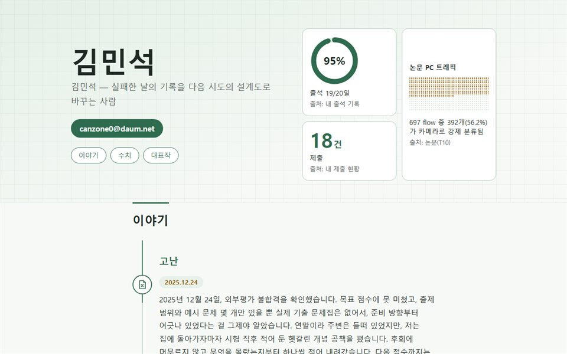
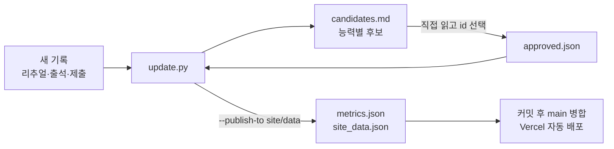

# kms-portfolio

실패한 날의 기록을 다음 시도의 설계도로 바꾼 이야기, 출처가 붙은 수치, 대표작을 한 페이지에 모은 포트폴리오 사이트와, 새 기록으로 수치·문단 후보를 다시 만들어 주는 자동 갱신 프로그램입니다. (ALEPH 과정 과제 12)

**[라이브 데모](https://kms-portfolio-site.vercel.app/)** · [자동 갱신 프로그램 상세](updater/README.md)



## 목차
[주요 기능](#주요-기능) · [기술 스택](#기술-스택) · [빠른 시작](#빠른-시작) · [자동 갱신 흐름](#자동-갱신-흐름) · [프로젝트 구조](#프로젝트-구조) · [설계 결정과 배운 점](#설계-결정과-배운-점) · [한계와 다음 할 일](#한계와-다음-할-일) · [연락](#연락)

## 주요 기능
- **이야기 3부**: 고난 → 다시 일어선 날 → 더 나아진 현재. 날짜가 있는 장면으로 구성했습니다.
- **출처가 붙은 수치**: 출석, 리추얼 기록, 제출 현황, 논문 외부 검증 결과를 카드로 보여 주고, 각 수치 아래에 출처("내 출석 기록", "내 제출 현황" 등)를 적었습니다.
- **대표작**: 10번 논문 PDF, 날씨 정보판·플랜 다이어리 앱, 13번 과제 앱 [FlowCheck](https://flowcheck-one.vercel.app/)(논문 결과를 직접 눌러 보는 웹앱, [저장소](https://github.com/ILB72/flowcheck))로 연결합니다.
- **승인한 기록 문장**: 자동 갱신 프로그램이 만든 후보 중 직접 승인한 문장만 능력별(자기조절력·대인관계력·자기동기력)로 표시합니다.
- **자동 갱신 프로그램**: 같은 입력이면 출력이 바이트 단위로 같은 결정적 실행, 승인한 후보만 반영, 이름·민감 문장 자동 제외.
- **테마 전환**: 맨 위 메뉴의 "테마" 버튼으로 시스템(기기 설정) → 라이트 → 다크 순서로 바꿉니다. 고른 값은 이 브라우저에만 저장되며, FlowCheck와 같은 방식입니다.
- 움직임 줄이기 설정을 따르고, 데이터 파일을 못 읽어도 HTML에 적힌 기본값이 보입니다.

## 기술 스택
- 사이트: HTML · CSS · 바닐라 JavaScript (빌드 없음), Vercel 정적 배포
- 갱신 프로그램: Python 3 표준 라이브러리만 사용 (설치할 패키지·API 키 없음)

## 빠른 시작
요구 사항: Python 3.8 이상.

```bash
git clone https://github.com/ILB72/kms-portfolio.git
cd kms-portfolio

# 1) 사이트 보기 (http://localhost:8000)
python -m http.server 8000 -d site

# 2) 갱신 프로그램을 합성 샘플 입력으로 실행
python updater/update.py --input updater/sample_input --out updater/output

# 3) 테스트 (14개)
python -m unittest discover -s updater/tests
```

실제 기록으로 사이트까지 한 번에 갱신·배포하려면 `python updater/publish.py --input <실데이터 폴더>`를 실행합니다([상세](updater/README.md)).

> [!NOTE]
> 사이트는 `data/*.json`을 `fetch`로 읽기 때문에 `index.html`을 파일로 직접 열지 말고 위 명령처럼 로컬 서버로 여세요.

## 자동 갱신 흐름
후보를 만드는 일과 사이트에 올리는 일을 분리해, 사람이 승인한 문장만 공개되도록 했습니다.



실제 기록은 저장소 밖 폴더에 두고 실행합니다. 자세한 절차, 입력·출력 형식, 분류 규칙은 [updater/README.md](updater/README.md)에 있습니다.

> [!WARNING]
> 입력 경로에 `sample_input`이 있거나, 입력 폴더가 `updater/` 안이거나, 리추얼 파일 첫 줄에 '합성'이 있으면 `--publish-to`는 아무것도 복사하지 않고 종료코드 2로 끝납니다. 합성 샘플이 실제 사이트에 올라가는 일을 막는 안전장치입니다.

## 프로젝트 구조
```
kms-portfolio/
├── site/                 정적 사이트 (Vercel 배포 루트)
│   ├── index.html, style.css, main.js
│   ├── data/             사이트가 읽는 metrics.json, site_data.json
│   └── assets/           대표작 이미지, 논문 PDF
├── updater/
│   ├── update.py         후보 생성·승인 반영·--publish-to
│   ├── sample_input/     공개용 합성 입력 (출석·제출 수치만 실제 값)
│   ├── output/           샘플 실행 결과와 2회 실행 비교 기록
│   └── tests/            단위 테스트 14개
├── docs/                 이력서·자기소개서·경력기술서 등 문서
└── docs/images/          README용 스크린샷
```

## 설계 결정과 배운 점
- **수치마다 출처를 붙였습니다.** 사이트의 모든 숫자 아래에 어디서 온 값인지 적고, 확정 전 출석 1일이 포함된 사실도 화면에 밝혔습니다. 검증할 수 없는 수치는 쓰지 않았습니다(외부 포트폴리오 PDF는 참고용으로만 사용).
- **갱신은 반자동으로 했습니다.** 후보 생성은 코드가, 공개 여부는 사람이 정합니다. 초기 구상의 반자동 방식을 `--publish-to` 옵션과 합성 입력 거부 안전장치로 보완했습니다.
- **같은 입력이면 같은 출력.** AI 호출·난수·현재시각을 쓰지 않고, 같은 입력으로 2회 실행해 4개 출력 파일의 SHA-256이 모두 일치함을 [기록](updater/output/run_compare.txt)으로 남겼습니다.
- **AI 초안의 사실 오류를 고쳤습니다.** 외부평가 불합격 장면에서 AI 초안이 "그날 밤", "기출 정보가 거의 없었다"고 쓴 부분을 실제 기억에 맞게 정정했고, 동료 검증 장면과 동료 칭찬 인용은 삭제했습니다.
- **공개 범위는 직접 정했습니다.** 이름·공개 이메일 1개·교육기관명·외부평가 연도 공개는 제가 결정했고, 공책 사진과 소개 페이지 캡처는 개인 정보성이 있어 쓰지 않았습니다.

## 한계와 다음 할 일
- 분류는 `KEYWORDS` 사전의 키워드 일치 수로 하므로, 사전에 없는 표현은 후보에서 빠집니다.
- 기록 내려받기와 문장 승인(`approved.json` 편집)은 수동입니다. 이후 반영·배포는 `publish.py` 한 번으로 끝납니다.
- 출석 수치에는 확정 전 1일이 포함되어 있습니다(기준일 2026-11-16).
- 테마 선택은 브라우저(localStorage)에만 저장되어 다른 기기로 이어지지 않습니다.

<details>
<summary>제출 시 확인 항목 요약</summary>

- 갱신 프로그램 단위 테스트 14개 통과, 샘플 입력 2회 실행 결과 일치
- 입력 원본·내부 노트는 `.gitignore`로 저장소 제외 (타인 실명이 들어 있을 수 있음)
- 실행에 환경변수·API 키 불필요

</details>

## 연락
canzone0@daum.net
